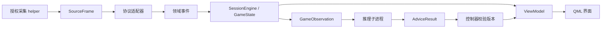

# 掼策 Guance

**本地牌局状态重建与模型建议桌面工具。**

Guance 面向 Windows 10/11 x64。在用户明确授权的本机环境中读取服务端牌局消息，将二进制记录转换为可校验的公开动作，再由本地 FableDan 模型给出候选建议。它不接管游戏操作，最终选择与实际出牌始终由用户完成。

> **开发版，不是已完成实机验收的发行版。** 本次文档整理以业务源码提交 `957b9c3` 为基线，另行记录已研究、但尚未随该基线提交的协议修正。文档更新不代表这些修正已发布。已知限制见下文；不要仅凭一张界面截图或一次测试成功就用于真实对局。

## 导航

- [功能与边界](#功能与边界)
- [快速开始](#快速开始)
- [技术栈](#技术栈)
- [架构与数据流](#架构与数据流)
- [报文如何变成牌局](#报文如何变成牌局)
- [牌码与座位](#牌码与座位)
- [本地模型如何工作](#本地模型如何工作)
- [界面与线程](#界面与线程)
- [配置与本地数据](#配置与本地数据)
- [测试与构建](#测试与构建)
- [目录与阅读路线](#目录与阅读路线)
- [已知限制](#已知限制)
- [贡献与第三方说明](#贡献与第三方说明)
- [完整文档](#完整文档)

## 功能与边界

| 模块 | 提供的能力 | 不代表什么 |
|---|---|---|
| 实时解析 | 校验二进制聚合、命令与 payload，生成标准化事件 | 不是通用协议探测器，也不保证未知版本兼容 |
| 状态重建 | 校验行动者、实体牌、剩余张数、公开动作顺序 | 不能凭空补齐丢失消息或推测对手手牌 |
| 模型建议 | 本人回合生成合法候选，对候选评分并排序 | 分数不是胜率承诺；不会自动执行 |
| 桌面界面 | 主窗口、设置、诊断、浮动建议和离线演示入口 | 演示成功不能证明真实采集与推理成功 |
| 授权采集 | 本地 helper、显式授权、代理恢复机制 | 不重放请求、不修改流量、不绕过权限 |
| 本地诊断 | 有界日志与用户主动导出 | 不自动上传诊断，不允许包含凭据或私钥 |

牌局异常时应停止使用当前建议；错误处理目标是 **fail-closed**，而不是用猜测保持界面看起来正常。解析层、状态层、模型层分别承担结构、一致性和牌型语义校验，三者不能相互替代。

## 快速开始

### 1. 准备环境

需要 Python **3.12 x64**。以下命令在仓库根目录执行，使用项目的 [pyproject.toml](pyproject.toml) 安装固定依赖，不依赖本地未提交的环境配置。

```powershell
py -3.12 -m venv .venv
.\.venv\Scripts\python.exe -m pip install -e '.[dev]'
.\.venv\Scripts\python.exe -c "import sys, struct; assert sys.version_info[:2] == (3, 12); assert struct.calcsize('P') * 8 == 64"
.\.venv\Scripts\python.exe -m guance --version
```

不必激活虚拟环境，也不需要修改终端执行策略。后文的 `python` 均指该虚拟环境中的解释器。

### 2. 启动界面

```powershell
.\.venv\Scripts\python.exe -m guance
```

首次启动先查看授权说明，不要在不知情时安装证书或开始采集。要查看演示，请在界面选择离线演示入口，不需要真实牌局。

**CLI 注意：** 当前入口虽解析 `--demo`、`--screenshot` 参数，但已检查的 GUI 启动代码没有消费这两个参数。不要把 `python -m guance --demo` 当成隔离演示保证。`--exit-after 3` 只安排自动退出，不会禁用 GUI 初始化、副作用或恢复流程。

### 3. 准备模型

模型权重不随源码仓库提交。仅使用来源可信、结构兼容且具有使用权限的 `best.npz`。

```powershell
$env:GUANCE_MODEL_PATH = 'D:\models\best.npz'
.\.venv\Scripts\python.exe -m guance
```

也可通过设置页导入模型。运行时模型路径与打包输入路径是两个不同概念：环境变量不会自动改写 `Guance.spec` 中的打包路径，详见 [构建指南](docs/BUILD.md)。

## 技术栈

依赖版本以 [pyproject.toml](pyproject.toml) 为准。

| 技术 | 当前固定版本或形式 | 在项目中的职责 |
|---|---|---|
| Python | `>=3.12,<3.13`，x64 | 编排、协议、领域状态与进程管理 |
| PySide6 | `6.11.1` | Qt 绑定、信号槽、窗口与事件循环 |
| Qt Quick / QML | 随 PySide6 提供，Controls Basic | 声明式 UI、布局、牌面和浮窗 |
| NumPy | `2.3.5` | FableDan 本地推理和权重数组 |
| mitmproxy / mitmdump | 外部准备的 frozen runtime | 授权环境中的服务端 WebSocket 消息采集 |
| pywin32 | `311`，仅 Windows 安装 | Windows 平台适配依赖；具体调用见适配模块 |
| PyInstaller | `6.21.0` | onedir 打包、Qt/QML 资源收集 |
| pytest | `9.1.1`，开发依赖 | 单元、协议、集成和界面回归 |
| 标准库 wire reader | 自有实现 | Protobuf wire 子集、packed varint、tnetstring |
| JSON Lines | 本地进程管道 | helper/worker 的逐行消息边界，不是网络 API |

这是 **PySide6 + QML** 项目，不是 Web 前端，也没有依赖 QFluentWidgets。协议解析不是通过官方 `.proto` 文件生成的客户端，而是对已观察结构进行受限解码。

## 架构与数据流



1. **采集进程**提供授权连接上的服务端二进制消息；采集与业务解析分离。
2. **协议层**处理长度、记录边界、wire 类型和 command/variant，不打开网络、不修改代理。
3. **领域层**维护实体牌、轮次、行动者和状态版本；不依赖 Qt 或 Windows API。
4. **控制器**连接 UI 意图、会话更新、采集生命周期和模型客户端。
5. **模型进程**只接收公开观察和本人手牌，不接收整份抓包。
6. **展示层**通过信号/属性更新，不在 QML 中实现协议或业务规则。

完整的启动、停止、异常恢复和跨进程限制见 [架构说明](docs/ARCHITECTURE.md)；数据字段与函数签名见 [集成契约](docs/INTEGRATION_CONTRACT.md)。

## 报文如何变成牌局

### 二进制分层

```text
WebSocket binary message
  -> 外层总长度 + 结构标记
  -> 动态位置的聚合头
  -> 子记录列表
  -> Protobuf envelope: field 1(command), field 3(wrapper)
  -> wrapper 中唯一的 variant
  -> command body
  -> 标准化事件
```

外层长度与记录头使用大端整数；payload 内 Protobuf varint 按其 wire 编码解码。`FF FD` 位于外层偏移 `8..9`；聚合候选起点从偏移 24 开始在有界范围内查找，并不是所有消息都固定从 24 开始。

子记录类型 `15815` 才进入当前 Protobuf 路径，版本要求为 `2`。其他记录类型跳过；目标类型的未知版本、命令/variant 不匹配或多个合法聚合起点会报错。没有目标标记或没有找到聚合可返回空事件，不能把它说成“每种未知字节都必定报错”。

### 常用命令速查

下表是研究和代码用途索引，不是服务端官方 schema。新增语义和已提交基线的差别在 [协议字段字典](docs/PROTOCOL.md) 逐项标注。

| command | 用途 | 关键 body 字段 |
|---|---|---|
| `3001` | 发牌 | `1` 数量、`2` packed 手牌、`3` 首家提示、`4` 级牌 |
| `3004` | 首出 | `1` 首家 scalar |
| `3005` | 出牌 | `2` 行动者、`3` 下一位、`4` 牌型、`5` 余牌、`6` 本次数量、`7` packed 出牌 |
| `3006` | 过牌 | `2` 行动者、`3` 下一位、`4` 重置标记 |
| `3008` | 结算 | `3` packed 名次、`13` repeated 结算手牌对象 |
| `3019` | 座位辅助证据，待合并 | `2` 候选座位、`3` 嵌套牌引用；不能单字段定座 |
| `3003` | 中性数值证据，待合并 | `4` 四字节序列、`5` 嵌套 fixed64 数值；不推断为加倍结果 |

**重要修正：** `3001.field 3`、`3004.field 1` 是 scalar，不是因为读取函数名包含 `nested` 就变成嵌套 message。`3001.field 6.field 3` 才是嵌套路径。基线错误地把 `3001.field 3` 直接用于本人座位；文档明确记录这一待合并修正，不将旧映射包装成可靠事实。

字段字典覆盖：字节偏移、长度、wire 类型、必选/可选、缺省值与字段存在性、合法范围、解析行为、状态影响、未知语义、合成示例和对应测试。历史回放与保存抓包读取也分别说明，不与实时消息混用。

## 牌码与座位

实体牌使用整数，而不是仅用牌点区分：

```text
code = (copy_index << 8) | (suit_code << 4) | rank_code
```

- `copy_index`：`0/1`，区分两副牌中相同的牌。
- 普通牌 `suit_code`：`1` 黑桃、`2` 红桃、`3` 梅花、`4` 方块。
- 普通牌 `rank_code`：`1` 为 A，`2..10` 为数字，`11/12/13` 为 J/Q/K。
- 大小王使用 `suit_code=0`、`rank_code=14/15`。
- 例：`0x12` 为第一副黑桃 2，`0x112` 为第二副黑桃 2，二者是不同实体牌。

绝对座位为 `0..3`，队友是 `(my_seat + 2) % 4`。显示相对座位与模型相对座位有各自的映射，不能直接复用。本人座位未知或证据冲突时应暂停推荐；升降序显示不能改变源牌码和动作历史。

## 本地模型如何工作

实现入口：[advisor.py](src/guance/infrastructure/model/advisor.py)、[client.py](src/guance/infrastructure/model/client.py)、[worker.py](src/guance/infrastructure/model/worker.py)。

1. 用 `np.load(..., allow_pickle=False)` 加载 `.npz`，校验特征维度、词表、浮点数组和有限数值，计算 SHA-256。
2. 把项目实体牌映射到模型的 `0..107` 编号，级牌从 `1..13` 转成 `0..12`。
3. 根据公开历史重建牌型、配牌和领出约束；不能唯一解释时返回错误。
4. 调用 `gen_moves()` 生成合法候选，不让模型凭空返回手牌之外的牌。
5. `encode_decision()` 编码历史 token 和候选特征；历史上下文只计算一次，候选分批评分。
6. 按评分排序，最多返回配置范围内的候选；再次检查候选实体牌属于本人手牌。
7. 返回绑定 `session_id + game_id + state_version + request_id` 的结果，控制器丢弃过期结果。

客户端使用容量为 1 的待处理请求队列，优先保留最新局面。推理在独立进程运行，限制数值库线程；超时或 worker 异常时清理进程，不静默切换成规则推荐。候选 `score` 是模型评分，不应显示为经过校准的胜率。

## 界面与线程

QML 描述布局，ViewModel 管理属性和意图，控制器执行实际业务。来自后台线程的记录复制后经 Qt queued signal 送到 UI 线程，避免后台直接操作控件。

主窗口与浮窗共用展示数据，进入浮窗不应该停止采集。关闭浮窗、停止助手和退出应用是三个不同动作。自动尺寸、固定记牌器和新的两列出牌布局仍属于未随本次提交发布的本地 UI 候选，不作为本次已完成能力展示。

## 配置与本地数据

| 项目 | 含义 |
|---|---|
| `%LOCALAPPDATA%\Guance` | 默认用户数据目录，非发布目录 |
| `GUANCE_DATA_DIR` | 覆盖本地数据目录，便于授权的隔离测试 |
| `GUANCE_MODEL_PATH` | 运行时模型路径覆盖 |
| `config/preferences.json` | 用户偏好，不提交 |
| `certs/`（基线）、`config/mitmproxy/`（待合并修正） | 本机 CA 材料；以 `app_paths()['cert_dir']` 为准，不提交、不随包迁移 |
| `logs/`、`exports/` | 本地日志与用户主动导出 |

开发环境内部 profile 标识为兼容而保留；公共文档统一称为 `<profile>`。不要把占位符直接当成一个需要新建的真实目录，也不要为了去除文档名称而重命名运行路径。

## 测试与构建

```powershell
.\.venv\Scripts\python.exe -m compileall -q src tests
.\.venv\Scripts\python.exe -m pytest tests/protocol tests/domain -q
.\.venv\Scripts\python.exe -m pytest tests/presentation tests/ui_acceptance -q
.\.venv\Scripts\python.exe -m pytest tests/runtime tests/integration tests/acceptance -q
.\.venv\Scripts\python.exe -m pytest -q
git diff --check
```

以上是验收命令，不是本次全量测试通过声明。offscreen 测试不能证明真实桌面点击、DPI、多屏、证书或代理已经验收。

本次将手工维护的 [Guance.spec](Guance.spec) 纳入版本控制。准备好本地模型、图标和完整采集 runtime 后，可显式使用该规格构建：

```powershell
.\.venv\Scripts\python.exe scripts/prepare_runtime.py
.\.venv\Scripts\python.exe -m PyInstaller --noconfirm --distpath release --workpath build/pyinstaller Guance.spec
```

**本次不提交本地修改过的构建脚本。** 基线 `scripts/build_release.py` 仍是旧命令行构建路径，可能重新生成同名 spec；使用本次保存的规格时请采用上面的显式命令。如何准备路径和资产、如何验证完整 onedir 目录见 [BUILD](docs/BUILD.md) 与 [RELEASE](docs/RELEASE.md)。

## 目录与阅读路线

```text
src/guance/
  __main__.py              CLI 分派
  bootstrap.py             Qt 与控制器组合入口
  contracts.py             跨层不可变数据结构
  domain/                  牌码、事件、状态机、会话
  application/             控制器与运行时编排
  infrastructure/
    protocol/              二进制、wire、实时、离线回放
    capture/               addon 与 helper 管理
    windows/               代理/证书适配
    model/                 worker、模型适配和上游运行时
  presentation/            ViewModel、格式化、QML
tests/                     分层回归和 UI 验收
scripts/                   构建/runtime 工具
docs/                      技术与使用文档
Guance.spec                手工维护的构建规格
```

建议阅读顺序：`contracts.py` → `domain/cards.py` → `protocol/wire.py` → `protocol/live.py` → `domain/state.py` → `domain/session.py` → 控制器 → 模型适配 → ViewModel/QML。

## 已知限制

- 已提交源码仍有本人座位字段解释问题；新的证据确认逻辑需独立合并和验收。
- 历史回放路径存在与 `ActionEvent` 构造签名不一致的代码，不能宣称历史回放端到端可用；详见协议文档。
- 模型、图标和采集 runtime 不是源码克隆后自动具备的资产。
- 本次不包含业务/UI 修复，也不是软件发布；本地未完成验收的功能不会因文档更新变为“已通过”。
- 未知玩法、进贡还贡、复杂重连与其他网络组合需追加证据和回归，不靠猜测兼容。

## 贡献与第三方说明

提交前保留层间边界，为修复补充回归测试，并按 [验收标准](docs/ACCEPTANCE_STANDARD.md) 记录通过、失败、跳过和未验证项。不要提交模型、真实抓包、CA 私钥、账户凭据、个人日志或本机代理设置。

仓库目前没有为项目自有代码提供根目录许可证文件，本次不会擅自选择许可证。上游 FableDan 代码保留 [许可证](src/guance/infrastructure/model/fabledan_vendor/FABLEDAN_LICENSE) 和 [revision](src/guance/infrastructure/model/fabledan_vendor/FABLEDAN_REVISION)；公共文档去品牌化不删除第三方署名与许可证。权重的使用和再分发也应单独确认。

## 完整文档

| 文档 | 内容 |
|---|---|
| [用户指南](docs/USER_GUIDE.md) | 安装、启动、授权、演示、停止、浮窗与排障 |
| [架构](docs/ARCHITECTURE.md) | 分层、线程/进程、数据流、状态与安全边界 |
| [协议字段字典](docs/PROTOCOL.md) | 头部偏移、wire 类型、命令字段、历史格式、证据等级 |
| [集成契约](docs/INTEGRATION_CONTRACT.md) | 数据结构、信号槽、IPC、失效规则 |
| [安全](docs/SECURITY.md) | 授权、代理恢复、敏感数据、导出和分享限制 |
| [诊断](docs/DIAGNOSTICS.md) | 日志、错误定位和恢复路径 |
| [构建](docs/BUILD.md) | 依赖、本地资产、spec、打包命令和检查 |
| [发布](docs/RELEASE.md) | 目录交付、验收、版本与目标机检查 |
| [验收入口](docs/ACCEPTANCE.md) | 验收材料和本次文档提交边界 |
| [验收标准](docs/ACCEPTANCE_STANDARD.md) | P0/P1/P2 门槛和证据格式 |
| [UI 验收](docs/UI_ACCEPTANCE.md) | 控件动作、预期状态和实机限制 |

本文的组织参考 Ruff、mitmproxy README 的快速开始、用法和详细文档索引方式；实现说明来自仓库源码及测试，不复制其他项目的产品能力或验收结论。
